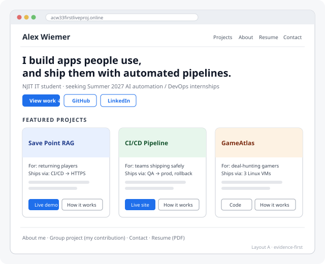
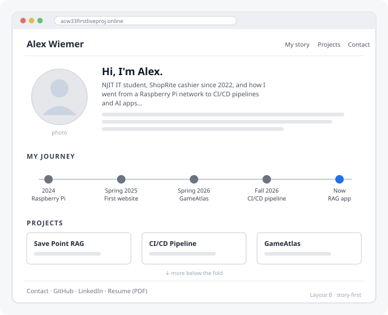

# IS373 Individual Record: Alex Wiemer

**Course:** IS373 Content Management Systems, NJIT, Fall 2026 · **GitHub:** [ACW900](https://github.com/ACW900)

This record holds my two individual deliverables. My group work (Deliverable 3) is in my team's shared record.

| Section | Contents |
|---|---|
| [1. Individual portfolio + career research](#1-individual-portfolio--career-research) | Employer postings, two directions compared, target reader, evidence map, outline, layouts |
| [2. Individual RAG app + technical research](#2-individual-rag-app--technical-research) | Reader/question, sources, vector/graph/keyword comparison, architecture, evaluation questions, checks, hosting |

**Status labels:** `planned` · `observed locally` · `observed in CI` · `observed hosted`. A plan, sketch or expected answer is not an executed test.

**Stage:** Review 1 (Plan), due Nov 17, 2026. No hosted app is required yet; planned URLs are labeled.

---
## 1. Individual portfolio + career research

### Index

| Item | Where | Status |
|---|---|---|
| 4 employer posting records | [A](#a-employer-posting-records) | checked Nov 16, 2026 |
| Comparison of 2 directions | [B](#b-comparing-two-directions) | written |
| Target reader + direction | [C](#c-target-reader-and-direction) | chosen (provisional) |
| Private reflection | [D](#d-private-reflection-not-public) | private |
| Responsibility → evidence map | [E](#e-responsibility-to-evidence-map) | written (each row labeled observed / planned) |
| Portfolio outline | [F](#f-portfolio-outline) | written; site planned for Build |
| Two layout options + choice | [G](#g-two-lightweight-layouts) | wireframed; Layout A chosen |
| Peer check + changed/checked/next | [H](#h-peer-check-and-changed--checked--next) | peer check pending |

---

### A. Employer posting records

*All three were opened on the employer's own site on **Nov 16, 2026**. Responsibilities are paraphrased. Re-open each one and add the date **you** checked it.*

#### P1: Forward Deployed Engineer (FDE), OpenAI *(required FDE reference)*

| Field | Notes |
|---|---|
| Role family | **Forward deployed engineering** |
| Employer / industry | OpenAI · AI research and deployment |
| URL | https://openai.com/careers/forward-deployed-engineer-(fde)-sf-san-francisco/ |
| Date checked | Nov 16, 2026 |
| Posted / deadline / status | Not stated on the page · open when checked |
| Location / arrangement | San Francisco · hybrid, 3 days/week in office · **up to 50% travel** · relocation offered |
| Level / eligibility | **Senior: 5+ years** engineering or deployment experience with customer-facing work. **Longer-term reference, not something I qualify for now.** |
| 3 responsibilities (my words) | 1. Take customer AI deployments from first prototype to stable production. 2. Work inside customer teams to understand their needs and help them adopt what's built. 3. Turn repeated solutions into reusable tools/playbooks and send field feedback to product and research. |
| Required | 5+ yrs incl. customer-facing work; production frontend + backend code (Python/JS); has built or deployed LLM-powered systems |
| Preferred | Delivering complex systems in ambiguous settings; clear communication with engineers and customers |
| Short excerpt | "Own technical delivery across multiple deployments from first prototype to stable production" *(In this role you will)* |
| Something I've actually done | Took Save Point from spec to merged, tested features through issues/PRs with CI (App Studio APP-001–003) |
| Gap | No customer-facing delivery; no LLM-powered system yet |
| My impression *(my assumption about fit, not a posting fact)* | From reading the role description, this job seems very based around results and not very structured or boxy. |
| Next action (dated) | Build the RAG app's first real source → answer path by **Nov 24** (Review 2) |

#### P2: AI Engineer (MLOps) Intern, New York Life *(junior / internship)*

| Field | Notes |
|---|---|
| Role family | **Platform / MLOps** (with AI engineering) |
| Employer / industry | New York Life Insurance Company · financial services / insurance |
| URL | https://careers.newyorklife.com/careers/job/43624352-2027-technology-data-ai-ventures-summer-internship-program-ai-engineer-mlops-intern-new-york-new-york-united-states |
| Date checked | Nov 16, 2026 |
| Posted / deadline / status | Requisition 94548 · deadline not stated on the employer page · **Likely closed:** the direct page still loaded Nov 16, but the TDAV internships no longer appear in New York Life's job search, and one third-party listing said it expired Nov 15. It still works as research evidence; just don't count on applying. |
| Location / arrangement | New York, NY · hybrid, 3 days/week on-site · 11 weeks, May 25 – Aug 6, 2027 · $30–35/hr + $3,000 bonus |
| Level / eligibility | **Internship.** Bachelor's/master's student graduating **Dec 2027 or May 2028**; must be authorized to work in the U.S. (no sponsorship, no OPT/CPT). **My expected graduation: Fall 2027 / Spring 2028, which matches. Confirm the exact term and my work authorization when applying.** |
| 3 responsibilities (my words) | 1. Help deploy ML and generative AI models into production with Python APIs. 2. Improve MLOps/DevOps platforms with dashboards and monitoring (e.g. New Relic). 3. Contribute to automation that keeps models reliable at scale. |
| Required | CS/data/AI-related degree in progress; Python; APIs; automated testing; DevOps tools (examples given: EKS, CI/CD, New Relic) |
| Preferred | Not separately listed |
| Short excerpt | "designing and testing new patterns for model deployment using Python APIs" *(What You'll Do, example projects)* |
| Something I've actually done | Built a QA → production **CI/CD pipeline** (Docker image → GHCR → SSH deploy, health check, rollback) for acw33firstliveproj.online; automated tests + CI in Save Point |
| Gap | No ML/LLM model in production; no monitoring/observability tool; no Kubernetes/EKS |
| My impression *(my assumption about fit, not a posting fact)* | I like the "What You'll Do" section because it gives actual tasks for what you're supposed to be doing. I think this is something the OpenAI posting is missing. |
| Next action (dated) | Deploy the RAG app through my existing pipeline with a health check and basic logging by **Dec 3** (Review 3) |

#### P3: Product Engineer, Computer Use, Anthropic *(alternative direction)*

| Field | Notes |
|---|---|
| Role family | **AI product engineering** |
| Employer / industry | Anthropic · AI research and products |
| URL | https://job-boards.greenhouse.io/anthropic/jobs/5238637008 |
| Date checked | Nov 16, 2026 |
| Posted / deadline / status | Not stated · open when checked |
| Location / arrangement | San Francisco, **New York City**, or Seattle · in office at least 25% of the time |
| Level / eligibility | **Experienced:** asks for zero-to-one product ownership and shipping to external users. **Longer-term reference.** Visa sponsorship possible. |
| 3 responsibilities (my words) | 1. Own computer-use/browser-control product features end to end: scope, build, ship, measure, iterate. 2. Find and fix reliability problems in the agent system that block real use. 3. Turn vague user pain points into concrete features, using usage data to prioritize. |
| Required | Shipped a product 0→1 with end-to-end ownership; strong full-stack web skills; hands-on with LLM APIs/prompting/agents; iterating on external user feedback |
| Preferred | Product design instincts; browser/desktop automation; building evals; light data analysis (SQL); agent loops/guardrails |
| Short excerpt | "Translate fuzzy user pain points into concrete, shippable features for knowledge workers" *(Key responsibilities)* |
| Something I've actually done | Designed Save Point around a specific user ("a gamer looking for news about his favorite games") and made product decisions in its SPEC; full-stack FastAPI + templates + SQLite |
| Gap | No LLM API work yet; no real external users or usage data; no evals yet |
| My impression *(my assumption about fit, not a posting fact)* | I feel this is the job I align with most. It describes things I've been doing for years now, and the information is very cleanly laid out. *(Name which things specifically, e.g. troubleshooting, building full-stack apps, designing for a user.)* |
| Next action (dated) | Write and run the RAG app's 5 evaluation questions and record actual results by **Dec 3** |

#### P4 (extra, open now): AI/Automation Development Intern – Assessment & Authorization, Leidos *(AI automation)*

*An extra posting beyond the required three. It matches my AI automation goal and was **open with applications accepted** when checked.*

| Field | Notes |
|---|---|
| Role family | **AI automation** (close to data/evaluation and security in the handout's families) |
| Employer / industry | Leidos · defense / government IT contractor (SMIT contract) |
| URL | https://leidos.wd5.myworkdayjobs.com/External/job/6314-RemoteTeleworker-US/AI-Automation-Development-Intern---Assessment---Authorization_R-00195319 |
| Date checked | Nov 16, 2026 |
| Posted / deadline / status | Originally posted Nov 6, 2026 · req R-00195319 · **accepting applications** when checked · no close date stated (Leidos only promises at least 3 days open, so apply soon) |
| Location / arrangement | **Remote (US)** · full time · internship dates **not stated**, so confirm it's summer 2027 |
| Level / eligibility | **Internship**: degree in CS/IT/cybersecurity/related (junior or senior standing preferred). **Must be a U.S. citizen (I am ✅) and able to get a Secret clearance** (involves a background check). Listed range $48,100–$86,950 (annualized). |
| 3 responsibilities (my words) | 1. Write automation scripts (Python, PowerShell, JS or Bash) that speed up security-authorization (RMF) paperwork and workflows. 2. Help build and test AI-enabled tools that analyze security controls and authorization packages. 3. Document what's built, join code reviews, and test/QA the automation. |
| Required | Scripting in Python, PowerShell, JavaScript or Bash; clean documented code; basic automation concepts; communication; **U.S. citizen + Secret clearance eligibility** |
| Preferred | AI/ML libraries or OpenAI API; AI coding assistants; RPA tools; LLMs for documents; Git/GitHub; REST APIs; cloud; **DevOps and CI/CD**; SQL/NoSQL; Agile |
| Short excerpt | "Develop and maintain automation scripts to streamline RMF processes and A&A workflows" *(Primary Responsibilities)* |
| Something I've actually done | IT340 Bash scripts (cron logging of uptime/memory/disk; interactive timesheet); GitHub Actions CI/CD pipeline; Git/GitHub with issues and PRs; JavaScript (Node/Express) |
| Gap | No AI/LLM tooling built yet; no PowerShell; no cybersecurity compliance (NIST RMF) background |
| My impression *(my assumption about fit, not a posting fact)* | This one interests me because it mentions testing in a workplace setting, and I'm not sure what that would involve. I have experience troubleshooting and finding bugs, but I don't know if that's what's required. |
| Next action (dated) | Citizenship confirmed. Confirm the summer 2027 dates, then apply **this week (by Nov 20)**. Mention the IS373 RAG app only once it's actually built. |

**Note on these sources:** P1 and P3 came from the instructor's career handout source leads (checked there Nov 3). P2 came from a web search and was confirmed on New York Life's own careers site. P4 came from a public internship tracker (github.com/zshah101/Automated-List-Of-Summer-2027-and-Fall-2026-Tech-Internships) and was confirmed on Leidos's own Workday page. Four postings are a small sample, not proof of what the whole job market wants.

---

### B. Comparing two directions

| Question | **Direction 1: Platform / MLOps** (P2) | **Direction 2: AI product engineering** (P3) |
|---|---|---|
| What would I do regularly? | Deploy models/services, automate pipelines, monitor reliability | Build user-facing AI features end to end, fix reliability issues, iterate from usage |
| What attracts me / what doesn't? | I feel like this is something I could go into with more confidence. I have full-stack experience and could be on the ground floor of AI integration in web development. The New York Life posting also lists actual tasks ("What You'll Do"), so I can picture the work. | This is the posting I align with most; it describes work I already do, and it's clearly laid out. But I feel like I don't know much about real AI skills yet; the only things I know are how to prompt and the basics of how LLMs work. It's also a senior role, not an entry point yet. |
| What can I show today? | CI/CD pipeline with QA/prod + rollback; Docker; HTTPS with Caddy; calculator deploy; IS373 practical test on secure deployment | Save Point: user-focused design, auth, roles, tests, CI |
| Biggest gap | ML/LLM in production; monitoring; Kubernetes | LLM APIs; real users; evals |
| Can IS373 help? | Yes: hosting the RAG app with persistence, health checks, secrets | Yes: the RAG app's user question → answer + evaluation |
| Junior entry point found? | **Yes**: P2 internship | Not yet: P3 is senior |

**FDE (P1)** combines both: building and deploying for a customer. It's a useful long-term reference, but it needs years of experience and heavy travel.

---

### C. Target reader and direction

**Provisional direction: a product-minded engineer who can also ship it.**
- **Where I lean:** AI product engineering (P3). It's the posting I align with most: understanding a user's problem, building the feature front to back, and improving it.
- **Where I'll start:** DevOps / AI automation internships (P2, P4). They have real entry points for summer 2027, and they match my strongest evidence (my CI/CD pipeline, Bash automation, troubleshooting).
- **Why both:** many people enter through infrastructure and automation and move toward product work. Knowing how to deploy and run what I build also makes me a stronger product engineer.
- **Longer term:** AI automation / AgentOps and AI infrastructure; FDE (P1) is a possible later path, since it combines building for users with deploying.

**Near-term target:** summer 2027 internships in AI automation, AI engineering, DevOps or cloud.

**Primary reader:** an **internship reviewer hiring for AI automation, AI engineering or DevOps intern roles** (like P4 and P2).

**What they should understand after one visit:**
> "This student builds useful apps for real users, and can take them from code to a tested, live deployment, with the evidence to show it."

**What I should *not* claim:** professional production experience, finished features that aren't built, or skills I haven't shown (Kubernetes, ML training).

---

### D. Private reflection (not public)

*My private reflection (two directions, my leaning, evidence, gap, dated action, and what the research changed) is submitted in the Canvas text box, not published here.*

---

### E. Responsibility to evidence map

| Employer responsibility (source) | Evidence I'll feature | Status |
|---|---|---|
| Deploy AI/ML systems to production with Python APIs (**P2**) | RAG app (FastAPI) deployed through my CI/CD pipeline to a live HTTPS URL | planned (Build, Nov 24) |
| Improve reliability with monitoring and automation (**P2**) | Existing pipeline: automated tests, image smoke test, health check, automatic rollback. Debugged a Caddy 502 by reading the logs and fixing a container missing from the Docker network. IT340 cron scripts logging uptime/memory/disk. Add basic logging/health page for the RAG app. | pipeline + 502 fix **observed hosted**; RAG monitoring planned |
| Take a deployment from prototype to stable production (**P1**) | Save Point: issue → branch → PR → CI for each feature; RAG app going Plan → Build → Checked Release | App Studio **observed in CI**; RAG planned |
| Turn user pain points into features (**P3**) | Save Point's user, promise, and design decisions in its SPEC; RAG reader/question (patch notes) | SPEC done; RAG planned |
| Build evals / measure quality (**P3** preferred) | RAG evaluation: 5 questions with expected sources, actual results, missing-evidence case | planned (Dec 3) |
| Work with a team (**P1**) | Group project case study naming my contribution | planned |
| Understand users and build full stack (**P3**) | GameAtlas: frontend → Express API → MongoDB across separate VMs | **observed** (Spring 2026, IT 340) |

**Evidence links:**
- CI/CD pipeline: https://github.com/ACW900/IS-373-TEST-CICD · live: https://acw33firstliveproj.online (QA: https://qa.acw33firstliveproj.online)
- Save Point (App Studio): https://github.com/ACW900/IS373_APPSTUDIO *(local app; not hosted yet)*
- GameAtlas: https://github.com/ACW900/IT340-Group-Project-
- Planned portfolio URL: https://acw33firstliveproj.online *(planned; not built yet)*

---

### F. Portfolio outline

| Page / section | What goes there |
|---|---|
| **Home / intro** | Name, one-line direction ("I build apps people use, and ship them with automated pipelines"), 3–4 featured projects, links to GitHub/LinkedIn/resume |
| **Full-stack app case study** | GameAtlas (frontend → Express API → MongoDB across VMs) and/or Save Point: who it's for, what I built, what I'd fix next |
| **RAG app case study** | Problem (returning players + patch notes), architecture, source → answer trace, evaluation results, limits, **link to the live chat** |
| **Deployment / platform case study** | My CI/CD pipeline: QA → production, rollback, health checks, what broke and how I fixed it |
| **Group project case study** | The shared system and **my named contribution** (with PR/issue links) |
| **About + contact** | Short background, what I'm learning next, professional contact route |

**Rules for the site:** no account needed to view it; mobile-friendly; keyboard-navigable; working links; anything unfinished labeled honestly.

**Where it will live (planned):** `https://acw33firstliveproj.online` (replacing the current placeholder page), deployed through my existing `qa` → `main` pipeline. *Confirm this is what you want.*

---

### G. Two lightweight layouts

*Same content, two arrangements.*

**Layout A: Evidence-first**



**Layout B: Story-first**



*Wireframes made with Claude from my layout descriptions; I chose the content and the comparison.*

| | **Layout A: Evidence-first** | **Layout B: Story-first** |
|---|---|---|
| Home page | Short intro line → **grid of project cards** (each: one sentence, a "live demo" link, a "how it works" link) | Longer intro about my path → projects appear further down as a narrative |
| Case studies | Separate page per project, with the same headings each time (Problem · Approach · Evidence · Limits) | One long scrolling page telling the story in order |
| Good for | A reviewer skimming 30 seconds for proof | A reader who wants to understand me as a person |
| Risk | Can feel impersonal | Evidence is buried; reviewers may leave before finding it |

**How the postings drove these design decisions:**

| Employer evidence | Portfolio decision |
|---|---|
| P3: turn user pain points into shippable features | Every project card starts with **"For: …"** (who it's for) |
| P2 / P4: deploy, automate and test reliably | Every project card shows **"Ships via: …"**, with a deployment case study |
| P1: prototype → stable production | The RAG case study shows Plan → Build → Checked Release, with evidence at each stage |
| P2 / P4 are internships with reviewers who skim | Evidence-first layout: live demos and code one click from the homepage |

**Provisional choice: Layout A (evidence-first).** My reader is an internship reviewer checking for proof that I can build *and* ship, so the live demos and evidence need to be one click away. Each project card can show both sides: "who it's for" and "how it's deployed." *This is a design hypothesis; the peer check at Improve will test it.*

---

### H. Peer check and changed / checked / next

**Peer check:** a real classmate reviewed my postings, target reader (C) and layouts (G): *"Looking at these postings, does my target reader and featured evidence make sense?"*
- Peer: [name] · Date: [ ]
- What they said: [ ]
- My decision / what I changed: [ ]

**Changed:** researched 4 employer postings across 4 role families (FDE, platform/MLOps, AI product engineering, AI automation); compared two directions; chose a provisional direction (lean toward AI product engineering, enter through DevOps / AI automation internships) and reader (AI automation / AI engineering / DevOps internship reviewer); mapped responsibilities to evidence; outlined the site; wireframed two layouts and chose evidence-first.
**Checked (actually done):** opened all 4 postings on the employers' own sites on Nov 16, 2026 and confirmed my notes and excerpts match. Peer check: see above.
**Next:** build the portfolio foundation (intro, navigation, labeled project placeholders) on acw33firstliveproj.online for **Build, Nov 24**; apply to the Leidos internship (P4) by Nov 19.

**AI help:** Claude (an AI assistant) found and summarized the job postings, drafted this section's structure, and made the two layout wireframes from my descriptions. I opened and checked every posting myself, wrote my impressions of each, chose the direction (from options Claude explained), and chose the layout.

---

## 2. Individual RAG app + technical research

### Index

| Item | Where | Status |
|---|---|---|
| Research question + reader | [A](#a-reader-and-question) | written |
| Technical sources + dates checked | [B](#b-technical-sources) | listed; reading in progress |
| Vector / graph / keyword comparison | [C](#c-comparing-approaches) | written |
| Architecture choice | [D](#d-chosen-architecture) | chosen (provisional) |
| Source manifest | [E](#e-source-manifest) | 5 sources collected; permission: unsure, expecting it to be covered in class |
| Sample representation (source → chunk → answer trace) | [F](#f-one-source-traced-through-the-system) | planned (illustrative, not executed) |
| Evaluation questions | [G](#g-evaluation-questions) | written; expected sources recorded; not run |
| Stories / checks | [H](#h-observable-stories-and-checks) | planned |
| Hosting, cost and limits | [I](#i-hosting-cost-and-limits) | planned |
| Changed / checked / next | [J](#j-changed--checked--next) | peer walkthrough pending |

**Status labels I'll use:** `planned` · `observed locally` · `observed in CI` · `observed hosted`. A sketch or expected answer is **not** an executed result.

---

### A. Reader and question

**Product:** a RAG feature added to **Save Point**, my existing FastAPI app (App Studio repo: https://github.com/ACW900/IS373_APPSTUDIO).

**Why this fits:** Save Point's promise is *"New patch? Get caught up from the last time you played."* My App Studio SPEC records that the app has no real news source yet. RAG over official patch notes fills that gap.

**Game:** **Deadlock** (Valve, on Steam). Valve ships frequent balance updates that change specific heroes, abilities and items, which makes "what changed since I last played?" a real question.

**One-sentence goal:**
> Save Point helps **a returning Deadlock player** answer **"what changed since I last played?"** questions using **5 official Deadlock patch notes**.

**Reader:** a Deadlock player who stopped for a few weeks or months and wants to know what changed for the heroes, abilities and items they use, without reading every patch note.

**Research question:** For short, versioned patch notes, does vector retrieval find the right changes for plain-language questions better than a keyword baseline? What would a graph (patch → ability → hero) add for questions that span several patches?

---

### B. Technical sources

*Only claims I actually saw in each source go here. Dates are filled in as I read them.*

| # | Source | What I'm using it for | Date checked | What I learned (my words) |
|---|---|---|---|---|
| T1 | Course research handout: https://github.com/kaw393939/is373-studio/blob/main/docs/handouts/database-rag-research.md | Required concepts, comparison table | [date] | [ ] |
| T2 | Lewis et al. (2020), *Retrieval-Augmented Generation for Knowledge-Intensive NLP Tasks*: https://arxiv.org/abs/2005.11401 | Where the term "RAG" comes from | [date] | [ ] |
| T3 | SQLite FTS5 (full-text search): https://www.sqlite.org/fts5.html | Keyword baseline in the database I already use | [date] | [ ] |
| T4 | sqlite-vec: https://github.com/asg017/sqlite-vec | Vector search inside SQLite, so no new database server | [date] | [ ] |
| T5 | Qdrant documentation: https://qdrant.tech/documentation/ | Alternative: dedicated vector database + metadata filtering | not yet | To read later (before Build) |
| T6 | Neo4j documentation: https://neo4j.com/docs/ | Graph database alternative (also supports vector indexes) | not yet | To read later (before Build) |
| T7 | Course chunking handout: https://github.com/kaw393939/is373-rag/blob/main/docs/students/chunking.md | Chunking experiment design | Nov 17, 2026 | My first idea was to split each patch into buffs, nerfs and balance changes, but that would spread one hero's changes across different chunks. I'm keeping one chunk per hero per patch and putting buff/nerf in the metadata instead. |
| T8 | Course embeddings handout: https://github.com/kaw393939/is373-rag/blob/main/docs/students/embeddings.md | What embeddings are and aren't | Nov 17, 2026 | I thought embeddings would connect buffs and nerfs to the characters they change. Each chunk is actually its own vector, and similar meanings just land close together. Links like hero → patch → ability are a graph idea, not a vector one. |
| T9 | Course AI cost comparison: https://github.com/kaw393939/is373-rag/blob/main/docs/students/ai-costs.md | Choosing an embedding + generation provider | [date] | [ ] |
| T10 | Groq docs (generation provider I picked): https://console.groq.com/docs/models | Model names, rate limits, pricing for openai/gpt-oss-20b | not yet | To read before Build |

**AI help:** Claude (an AI assistant) drafted this plan's structure, suggested using Save Point with patch notes, and pulled the five official Deadlock patch notes from Steam's news feed. I chose Deadlock, I'm reading the technical sources myself, and I made the architecture choice below. AI-written explanations are checked against T1–T9 before I rely on them.

---

### C. Comparing approaches

| Approach | How it would work for Deadlock patch notes | Good for | Weak for | Example question |
|---|---|---|---|---|
| **Keyword baseline** (SQLite FTS5) | Match words in the question against patch-note text | Exact names ("Sinclair", "Rule, Ratannia!", "10-05-2026") | Different wording: notes say "damage reduced from 165 to 140", players ask "did they nerf it?" | "What changed for Sinclair in the 10-05-2026 update?" |
| **Vector** (embeddings) | Embed each chunk; find chunks closest in meaning to the question | Casual player language and paraphrases | Similar ≠ correct; can mix up patches or heroes with similar changes without metadata | "Did they make Celeste's Shining Wonder weaker?" |
| **Graph** | Nodes: `Patch`, `Hero`, `Ability`, `Item`. Edges: `(Patch)-[CHANGED]->(Ability)`, `(Ability)-[BELONGS_TO]->(Hero)`, `(Patch)-[CHANGED]->(Item)`, each linked to its supporting bullet | "Which patches changed Baba's Brew?", following one ability across patches in order | Edges have to be extracted correctly; missing or wrong edges give wrong answers; more work | "How has Baba's Brew changed across patches?" |
| **Hybrid** | Vector search to find passages + metadata (or a graph) to filter by patch date and hero | Mixed questions | More moving parts; has to prove it's worth it | — |

**What a graph would add:** Deadlock notes are lists of "hero: ability: old value → new value." Following one ability across patches (Baba's Brew cooldown went 25s → 27s → 28s) is a relationship question. I can get most of that with **metadata** on each chunk (patch date, hero, abilities) without running a separate graph database.

---

### D. Chosen architecture

**Choice (provisional): vector-first, with metadata, inside SQLite, compared against an FTS5 keyword baseline.** Graph is researched and documented but not built unless a check shows metadata isn't enough.

**Why:**
1. Most player questions are casual paraphrases ("did Celeste get nerfed?"), and vector search is built for that.
2. Patch date + hero **metadata filters** cover the main relationship questions ("since early October", "which patches changed Baba") without a graph database.
3. Save Point already uses **SQLite**. sqlite-vec + FTS5 keep everything in one persistent file, with **no new database server** on my droplet.
4. Small corpus (5 short patch notes), so a dedicated vector DB like Qdrant would be overkill. *(Alternative if sqlite-vec doesn't work on my setup: Qdrant in Docker, kept private on the Docker network.)*

**Backup plan if time runs short:** keyword baseline + vector only, no metadata filters, with the graph comparison documented in research only.

**What could change my mind (next experiment):** if Q3 (Baba's Brew across patches) fails with metadata filters, try a small graph of `(Patch)-[CHANGED]->(Ability)` edges and compare.

**Build location:** the existing Save Point repo, as features RAG-001 (import) → RAG-002 (retrieve) → RAG-003 (answer) → RAG-004 (deploy), each with its own issue, branch and PR. The graded App Studio version gets tagged first.

**Planned flow:**
```text
official patch note (S01–S05)
  → import (admin only, uses existing APP-003 roles) → clean text
  → chunk: one chunk per hero (or item group) per patch, keep source ID + patch date + hero + abilities
  → embed chunks (embedding model chosen before Build, version recorded)
  → store in SQLite: chunks table + FTS5 index + sqlite-vec index (persistent)
  → user question → embed with the SAME model → top-4 chunks (+ optional date/hero filter)
  → show retrieved chunk IDs first
  → send question + retrieved chunks to the generation model
  → answer with links to the patch note, or "I don't have patch notes covering that"
```

**Chunking experiment (planned):** compare **(a) one chunk per hero per patch** (Deadlock notes start each line with the hero or item name, so this is a natural boundary) with **(b) fixed 500-character chunks with 100 characters of overlap**. Record whether (b) splits one hero's changes across chunks or mixes two heroes, and the effect on Q1–Q4.

**Models (generation chosen Nov 17; embeddings still to choose before Build):**

| Role | Option A | Option B | Decision |
|---|---|---|---|
| Embeddings | Hosted embedding API | Small local embedding model on the droplet (watch RAM) | before Build, after reading T8 + T9 |
| Generation | **Groq: openai/gpt-oss-20b** (free tier: 1,000 requests/day) | Claude Haiku 5.5 (paid, cheap) as a backup / comparison | **Chose Groq gpt-oss-20b (Nov 17).** It is the starting point the course cost handout suggests, and the free tier covers a class demo. Not tested yet. |

---

### E. Source manifest

All five are official Valve patch notes, retrieved Nov 16, 2026 from the Steam News feed for Deadlock (app 1422450). They're also posted in the official changelog forum (https://forums.playdeadlock.com/forums/changelog.10/). Local copies are saved privately for import; they're not republished in this repo.

| ID | Title | Original URL | Publisher | Date | Chunks (planned, one per hero/item group) | Questions it should answer |
|---|---|---|---|---|---|---|
| S01 | Minor Update - 08-12-2026 | https://store.steampowered.com/news/app/1422450/view/1840944183775204 | Valve | 2026-08-12 | 13 (Apollo, Billy, Doorman, Drifter, Holliday, Ivy, Lash, McGinnis, Paige, Seven, Vindicta, Vyper, Wraith) | — (distractor for Q2–Q4) |
| S02 | Minor Update - 08-22-2026 | https://store.steampowered.com/news/app/1422450/view/1841579228672283 | Valve | 2026-08-22 | 2 (items, Celeste) | Q2 |
| S03 | Minor Update - 10-05-2026 | https://store.steampowered.com/news/app/1422450/view/1845383656394833 | Valve | 2026-10-05 | 3 (general, Rat King, Sinclair) | Q1 |
| S04 | Minor Update - 10-14-2026 | https://store.steampowered.com/news/app/1422450/view/1846651706676198 | Valve | 2026-10-15 | 4 (items, Baba, Street Brawl, Deadman Danny) | Q3, Q4 |
| S05 | Minor Update - 11-04-2026 | https://store.steampowered.com/news/app/1422450/view/1848664643339845 | Valve | 2026-11-05 | 8 (Healbane, Apollo, Baba, Celeste, Deadman Danny, Mo & Krill, Nurse Harrow, Rat King) | Q2, Q3, Q4 |

**Permission note:** these are publicly posted by Valve, but publicly readable doesn't automatically mean reusable. My plan: store the text only inside my class demo, show short excerpts in answers, always link back to the official Steam page, and **confirm with the instructor** that this is acceptable. If not, I'll switch to clearly labeled synthetic patch notes. *Status (Nov 16): not asked yet. I'm unsure what we're supposed to do for this part. I think the instructor will go over it during the class review, so I'll follow what's said there.*

**Stable ID rule:** `S0#` per patch note; chunk IDs `S0#-C##` in the order heroes appear. Re-importing the same patch must not create new rows. A new patch gets a new source ID; an edited patch replaces its old chunks.

---

### F. One source traced through the system

*Illustrative sketch, **not executed**. Replace it with a real trace at Build.*

| Step | Example |
|---|---|
| Source | `S02`, Deadlock Minor Update - 08-22-2026, Steam News, 2026-08-22 |
| Chunk | `S02-C02` (Celeste), includes the line: "Celeste: Shining Wonder damage reduced from 165 to 140" |
| Metadata | source_id=S02, patch=08-22-2026, date=2026-08-22, hero=Celeste, abilities=[Dazzling Trick, Radiant Daggers, Shining Wonder] |
| Embedding | model and dimensions recorded at Build |
| Question | Q2: "Did they make Celeste's Shining Wonder weaker?" |
| Expected retrieval | `S02-C02` and `S05-C04` (Celeste in the 11-04 patch) both in the top 4 |
| Expected answer | Yes. On Aug 22 its damage dropped from 165 to 140 and spirit scaling from 0.9 to 0.6 (its T2 upgrade now adds +0.45 scaling back) [S02-C02]. On Nov 4 its cooldown went from 160s to 170s and its slow from -32% to -28% [S05-C04]. |
| How it could fail | Keyword search misses it ("weaker" isn't in the text). Vector search could return only the Dazzling Trick lines, or another hero's nerf. A top-k that's too small could miss the November patch. The model could leave out the T2 compensation. |

---

### G. Evaluation questions

*Expected sources written down **before** running anything.*

| # | Type | Question | Expected source(s) | What would show a problem |
|---|---|---|---|---|
| Q1 | Exact term | "What changed for Sinclair in the 10-05-2026 update?" | `S03-C03` | Cites a different patch, or misses lines like Vexing Bolt now doing half damage to objectives |
| Q2 | Paraphrase | "Did they make Celeste's Shining Wonder weaker?" (notes say "reduced", never "weaker") | `S02-C02`, `S05-C04` | Keyword baseline misses it; vector misses one of the two patches |
| Q3 | Relationship (across patches) | "How has Baba's Brew changed across patches?" | `S04-C02`, `S05-C03` | Gets the cooldown order wrong (it went 25s → 27s → 28s) or misses one patch |
| Q4 | Useful (time filter) | "I stopped playing in early October. What changed for Deadman Danny since then?" | `S04-C04`, `S05-C05` | Only reports the October buffs and misses the partial November nerfs, or pulls in older patches |
| Q5 | **Unanswerable** | "When is the next Deadlock patch coming out?" | **None** | App guesses a date instead of saying the patch notes don't cover it |

---

### H. Observable stories and checks

| # | Story | Check | Status |
|---|---|---|---|
| 1 | As a returning player, I can see which patch note an answer came from and open it. | Every answer shows chunk IDs + a link that opens the right Steam patch note. | planned |
| 2 | As a returning player, I get an honest "I don't know" when the notes don't cover my question. | Q5 returns an insufficient-evidence message with no invented date. | planned |
| 3 | As the admin, I can re-import a patch note without creating duplicates. | Import S01 twice; chunk count stays at 13. | planned |
| 4 | As a visitor or member, I can't use the import controls. | Anonymous → 401/login, member → 403 on the import route (reuses APP-003 role checks). | planned |
| 5 | As the owner, my data survives a restart. | Restart the container and ask Q1 again; `S03-C03` still comes back. | planned |

---

### I. Hosting, cost and limits

- **Where (planned):** `https://savepoint.acw33firstliveproj.online`, deployed the same way as the calculator (Caddy route + my CI/CD pipeline, QA first, then production).
- **Note:** my server uses **Caddy**, not Traefik. Follow my Server Studio setup.
- **Storage:** SQLite file on a persistent Docker volume.
- **Secrets:** API keys only in server environment variables / GitHub Actions secrets, never in the repo or the browser.
- **Public-use limits (planned):** login required to chat (reuses Save Point accounts), 20 questions per user per day, 300-character max question, top-4 chunks per answer.
- **Cost estimate (rough, to confirm with real prices):** about 850 tokens per question (≈30 question + ≈600 for 4 chunks + ≈200 answer). At 50 questions/day ≈ 1.3M tokens/month, With Groq gpt-oss-20b ($0.075 in / $0.30 out per 1M tokens, from the course handout checked Nov 11) that is about $0.10 per 1,000 questions, and the free tier should cover it. This is a calculation, not a measurement. I'll log real token use per question. Set a spending cap if I ever move to a paid tier.
- **Droplet limits:** check RAM/CPU before choosing a local embedding model.
- **Unknowns to settle before Build:** which embedding model (hosted vs. local), whether sqlite-vec loads in my Docker image, the instructor's answer on patch-note permission.

---

### J. Changed / checked / next

- **Changed:** chose Deadlock patch notes for Save Point's RAG feature; collected 5 official patch notes (S01–S05) with source IDs; wrote 5 evaluation questions with expected chunks; chose vector-first in SQLite with an FTS5 baseline (provisional).
- **Checked (actually done):** pulled the 5 patch notes from Steam's official news feed on Nov 16, 2026 and confirmed each has a working Steam URL, date and the hero lines used in Q1–Q4 (observed locally).
- **Next:** follow up on patch-note permission after the class review → read T1–T9 → pick the embedding model (generation: Groq gpt-oss-20b, chosen) → tag the App Studio submission → build RAG-001 (import S01–S05) → first real retrieval trace, for **Build, Nov 24**.

**Peer walkthrough:** a real classmate follows S02 through section F without my explanation, then we discuss where Q2 could go wrong.
- Peer: [name] · Date: [ ]
- Their question / concern: [ ]
- My decision / what I changed: [ ]
